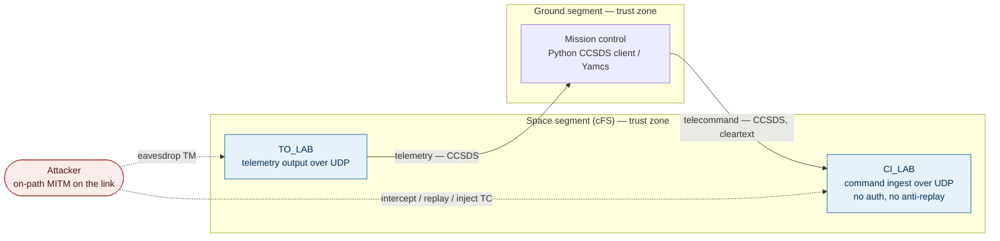

# Satellite Ground-Segment Security Lab

A hands-on security-architecture lab for a **simulated** satellite
command-and-control (C2) system. It demonstrates how an attacker can get an
unauthorised telecommand accepted by a spacecraft — and how a hardened
architecture stops it.

> ⚠️ **Lab only.** Everything here is simulated. No real RF is transmitted and
> no real satellite is ever contacted. Public data (e.g. SatNOGS) is used for
> offline analysis only.

**Status:** Phase 0 (scoping & architecture) complete · Phase 1 (baseline lab) next.

---

## What this project shows

Using NASA's open-source flight software as a stand-in spacecraft, the lab
builds a command/telemetry link, attacks it, and then re-architects it to defeat
the attack — with every control traced back to a documented threat.

**Goals**

1. A telecommand replay / injection attack **succeeds** against the baseline.
2. The same attack **fails** against the hardened design.
3. Every control traces to a threat in a threat model, mapped to **SPARTA** and
   **NIST IR 8401**.
4. The whole lab **rebuilds from this repo** with minimal commands.

**Background (space terms, briefly)**

- **TT&C** — Telemetry, Tracking & Command, the link between ground and spacecraft.
- **Telecommand (TC)** — an instruction sent *up* to the spacecraft.
- **Telemetry (TM)** — status data sent *down* from it.
- **CCSDS** — the standards body whose Space Packet format the link uses.

---

## Baseline architecture

The "before" picture — deliberately insecure. The hardened design arrives in
Phase 4.



The vulnerable surface is `CI_LAB`: it accepts CCSDS telecommands over UDP with
no authentication and no anti-replay, so any host on the link can command the
spacecraft. Full design rationale is in [`docs/`](docs/).

---

## Stack

| Layer | Choice | Why |
|---|---|---|
| Flight software | **NASA cFS** (`ci_lab`, `to_lab`) | Real NASA FSW in C; authentic unauthenticated CCSDS/UDP command ingest |
| Ground software | **Self-built Python CCSDS client** + **Yamcs** console | Learn-by-building + authentic packets; Yamcs as a real mission-ops UI |
| Link | Software-only **UDP** | Security lives at the packet layer; RF deferred to a later phase |
| Attacker | On-path **MITM** interposer | Container between ground and spacecraft on the Docker network |
| Orchestration | **Docker Compose** | One network, reproducible |
| Host | **GitHub Codespaces** | Repo-native, free tier, no local hardware needed |

Threats are mapped to **[SPARTA](https://sparta.aerospace.org)** (space-cyber
attacker techniques) and controls to **[NIST IR 8401](https://doi.org/10.6028/NIST.IR.8401)**
(ground-segment cybersecurity profile).

---

## Repository layout

```
.
├── .devcontainer/     # Codespaces / Dev Container setup (Docker enabled)
├── docs/              # architecture, system boundary, threat model, control mapping
│   └── adr/           # Architecture Decision Records
├── infra/             # Docker Compose files and service configs
├── attacks/           # attack scripts & MITM interposer        (Phase 3)
├── detections/        # alerting for suspicious command activity (Phase 5)
├── tests/             # automated checks
└── README.md
```

---

## Getting started

Everything runs in the cloud — you need only a GitHub account.

1. Open this repo → green **Code** button → **Codespaces** → **Create codespace on main**.
2. Wait for the first build (it installs Docker inside the Codespace).
3. In the terminal, confirm Docker works:
   ```bash
   docker run hello-world
   ```

That's the Phase 0 environment check. Phase 1 (bringing cFS up and getting
commands/telemetry flowing) is documented in [`docs/`](docs/) as it lands.

---

## Roadmap

- [x] **Phase 0** — Scope, system boundary, baseline architecture, ADRs
- [ ] **Phase 1** — Baseline lab: commands and telemetry end to end
- [ ] **Phase 2** — Threat model (data-flow diagram, SPARTA mapping)
- [ ] **Phase 3** — Attack: reproduce an unauthorised / replayed telecommand
- [ ] **Phase 4** — Hardened design (auth, anti-replay, segmentation, access control, logging), each as an ADR
- [ ] **Phase 5** — Detection: alerts for suspicious command activity
- [ ] **Phase 6** — Docs, diagrams, demo GIF, limitations
- [ ] **Later** — Software-defined RF link and link encryption

---

## Limitations

This is a learning and portfolio project, not an operational system. It
simulates the protocol and network layers of satellite C2; it does **not** model
RF/physical layers (until the RF phase), orbital dynamics, flight-qualified
software assurance, or production key management. Nothing here interacts with a
real spacecraft.

---

## License

Project code and documentation: **MIT** — see [`LICENSE`](LICENSE).

Third-party components are fetched during setup, not vendored, and keep their own
licenses — **cFS** (Apache-2.0) and **Yamcs** (AGPL-3.0). Cloning rather than
committing them keeps those terms off this repository.

---

## Author

**Hasala Kalubowila** — cybersecurity, moving toward security research in
firmware/embedded and space systems.
GitHub [@HPK13](https://github.com/HPK13) ·
[LinkedIn](https://www.linkedin.com/in/hasala-kalubowila)
