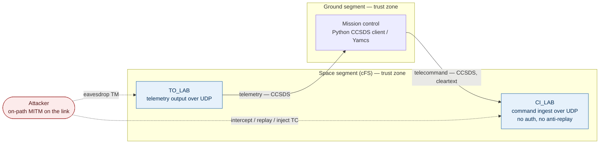

# Baseline architecture

Phase 0 sketch of the **baseline (deliberately insecure)** system. The hardened
architecture is introduced in Phase 4; this is the "before" picture the attack
in Phase 3 runs against.

## How to read it

- **Two trust zones** (ground, space) with the **link crossing between them**.
  In the baseline nothing enforces that boundary.
- **The vulnerable surface** is `CI_LAB`: it accepts CCSDS telecommand packets
  over UDP with no authentication and no anti-replay, so any host that can reach
  the port can command the spacecraft.
- **The attacker** is on-path on the link (a MITM interposer container). Solid
  arrows are the legitimate TC/TM flows; dashed arrows are the attack.

## What changes later

- **Phase 3** — reproduce an unauthorised / replayed telecommand across this link.
- **Phase 4** — introduce the hardened architecture (segmentation, command
  authentication, anti-replay, access control, logging); each control recorded
  as its own ADR and mapped to the threat it defeats.
- **Later realism** — software-defined RF link and link encryption, which is
  what makes the MITM "alter / eavesdrop" paths visibly defeated.
